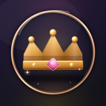

<div align="center">



# DEVIL'S ARCADE

**두뇌 서바이벌 아케이드 — 게임 6종**

[](https://pronongs-blip.github.io/)
[](#-games--6-titles)
[](#-%EC%9C%A0%EB%B0%B0%EC%A7%80-%EB%A7%8C%EA%B5%AD%EA%B8%B0)

<sub>아이폰 <b>Safari</b>에서 <b>공유 → 홈 화면에 추가</b> 하면 앱처럼 전체화면으로 열립니다.</sub>

</div>

---

## 🎮 Games — 6 Titles

| | 게임 | 한 줄 소개 | 플레이 |
|:--:|:--|:--|:--:|
| ♟ | **벽바둑 2** <br><sub>Wall Go Ⅱ</sub> | 7×7 보드, 벽으로 길을 막고 영역을 차지하는 1:1 전략 보드게임 (온라인 · AI · 3인전) | [▶ 열기](https://pronongs-blip.github.io/wall-baduk2.html) |
| ◐ | **흑과 백** <br><sub>Black & White</sub> | 0~8 타일의 흑·백만 보고 승부하는 9라운드 1:1 심리전 (온라인 · AI · 추리 메모) | [▶ 열기](https://pronongs-blip.github.io/black-white.html) |
| 🃏 | **기억포커** <br><sub>Memory Poker</sub> | 20초 암기 → 60초 선택, 내 2장 + 공용 3장으로 겨루는 9단계 족보 승부 (온라인 · AI) | [▶ 열기](https://pronongs-blip.github.io/memory-poker.html) |
| 🌐 | **유배지 만국기** <br><sub>World Flags</sub> | 30초 동안 10개 국기 3회 반복 암기 → 25개 보기 중 **5개** 찾기. 전 세계 **268종** 실제 국기 SVG, 온라인 1:1, **지옥 난이도**(유사 국기 낚시) | [▶ 열기](https://pronongs-blip.github.io/world-flags.html) |
| 🂠 | **인디언 포커** <sub>`NEW`</sub> <br><sub>Indian Poker</sub> | 내 카드는 모르고 **상대 카드만** 보이는 1~10 카드·칩 베팅 심리전. **10을 들고 폴드하면 −10칩** 페널티 (온라인 · AI · 한 기기) | [▶ 열기](https://pronongs-blip.github.io/indian-poker.html) |
| 🔍 | **틀린 그림 찾기** <br><sub>Spot the Difference</sub> | 12가지 그림에서 다른 곳 **5곳** 찾기. 60초 제한·힌트·오답 페널티, 한 기기 교대 대결과 온라인 1:1 | [▶ 열기](https://pronongs-blip.github.io/spot-diff.html) |

> 🌐 **유배지 만국기** 는 《데블스 플랜: 데드 어게인》 5일차 유배지 매치 규칙을 그대로 옮겼습니다.
> 아일랜드 ↔ 코트디부아르 ↔ 이탈리아, 차드 ↔ 루마니아 ↔ 몰도바처럼 **색 배열만 다른 국기**가 오답으로 깔립니다.

> 🎭 **닉네임** — 여섯 게임 모두 닉네임을 직접 입력합니다. 마지막에 쓴 이름은 `arcade_my_name` 으로 저장돼 다른 게임에서도 그대로 이어집니다.

---

## ✨ 특징

- **외부 CDN 없는 단일 HTML** — 앱마다 파일 하나, 라이브러리·폰트·이미지 요청 0. 오프라인에서도 그대로 동작합니다.
- **모바일 최적화** — 아이폰 13 미니(375×812) · 프로(390×844) 기준으로 5×5 국기 그리드와 게임 6장 목록까지 한 화면에 스크롤 없이 들어갑니다.
- **Web Audio 사운드 엔진** — 외부 음원 파일 없이 합성한 게임별 BGM과 효과음, 헤더의 `♪ | 🔊` 토글로 개별 온·오프(설정 공유).
- **고정코드 온라인 1:1** — Firebase 실시간 DB `/arcade_rooms/{게임}.json` 을 1.5초 간격으로 확인해, 아무도 방을 열지 않았으면 `🏠 고정코드 방 만들기`, 상대가 열어 두었으면 `⚡ 입장하기 (닉네임 님 대기 중)` 로 메인 버튼이 바뀝니다. 방은 코드 `0000` 하나이고 5분 지나면 자동 만료, 게임 시작·방 닫기·페이지 이탈 시 바로 지워집니다. 전송은 공개 브로커(`wss://broker.emqx.io:8084/mqtt`) 위의 미니 MQTT 클라이언트.
- **국기 268종 인라인 SVG** — 이모지가 아니라 실제 벡터 국기. 유엔 회원국 193개국 + 지역·자치령·기구기 전체를 4:3 규격으로 통일했습니다.
- **기록 배지** — 포털이 `localStorage`(`yg_arcade_stats_v2`)와 Firebase `/arcade_stats` 를 함께 읽어, 아직 안 해본 게임은 `NEW`, 온라인 대전이 쌓인 게임은 `N승 M패` 배지를 답니다.
- **📜 경기 기록** — 판이 끝날 때마다 승/패·상대·점수·시각을 `yg_arcade_history_v2` 와 Firebase `/arcade_history` 에 함께 저장합니다. **서로 다른 두 기기의 온라인 1:1 승부만** 남기고 AI전·한 기기 2인전은 저장하지 않습니다. 전적은 닉네임이 아니라 **기기(deviceId)** 로 묶여서, 이름을 바꿔도 같은 폰의 전적은 하나로 합산됩니다. 포털 하단 `📜 기록`에서 **전체 / 한 기기 / 온라인** 으로 걸러 보고, 기기별 전적(`기기 ID 끝 4자리 · 최근 닉네임`)과 연승을 확인합니다(최신 200경기 유지).
- **iOS 홈 화면** — Safari 공유 → 홈 화면에 추가. 전용 아이콘(`apple-touch-icon.png`)과 전체화면 메타 태그가 들어 있습니다.

---

## 🗂 구성

```text
pronongs-blip.github.io/
├── index.html            # 미래전략실 대문 (비서실·오락실·은우방 3대 앱)
├── office.html           # 비서실 (행동대장 HQ · 최저가 시세판·어미새 핫딜)
├── arcade.html           # 오락실 (아케이드 포털 · 게임 6종)
├── eunu.html             # 은우방 (소화어린이집 꽃들3반 · 알림장·식판)
├── wall-baduk2.html      # 벽바둑 2
├── black-white.html      # 흑과 백
├── memory-poker.html     # 기억포커
├── world-flags.html      # 유배지 만국기 (국기 268종 인라인 SVG)
├── indian-poker.html     # 인디언 포커
├── spot-diff.html        # 틀린 그림 찾기
├── home-icon.png         # 홈 화면 아이콘 (미래전략실 대문)
├── apple-touch-icon.png  # 홈 화면 아이콘 (오락실)
├── office-icon.png       # 홈 화면 아이콘 (비서실)
└── eunu-icon.png         # 홈 화면 아이콘 (은우방)
```

<div align="center">
<sub>새 게임이 완성될 때마다 이 광장에 하나씩 세워집니다</sub>
</div>
